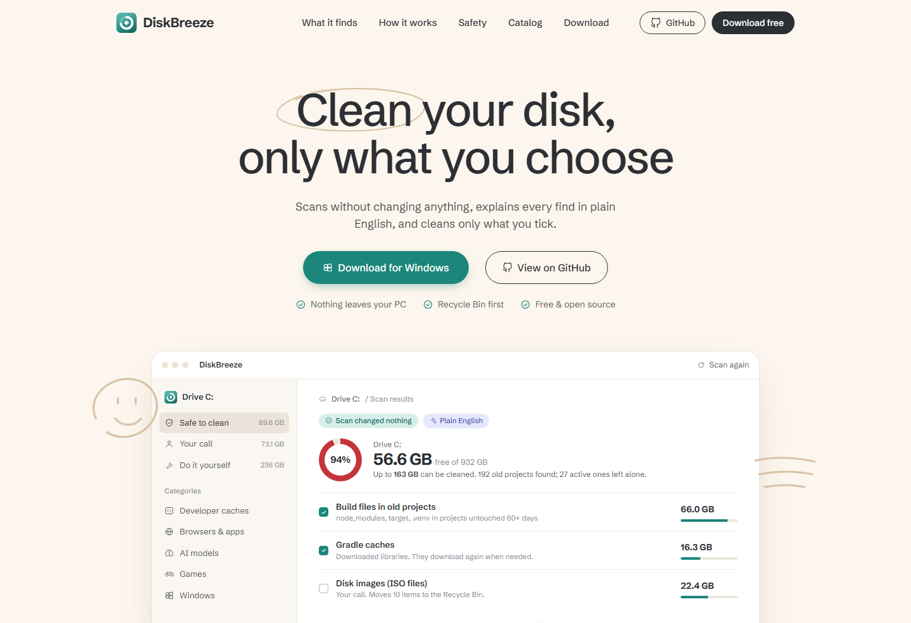
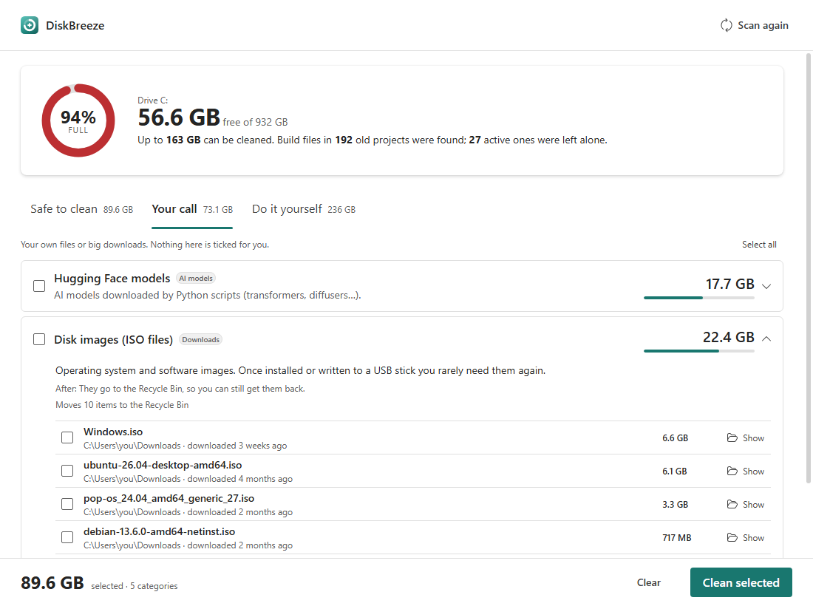
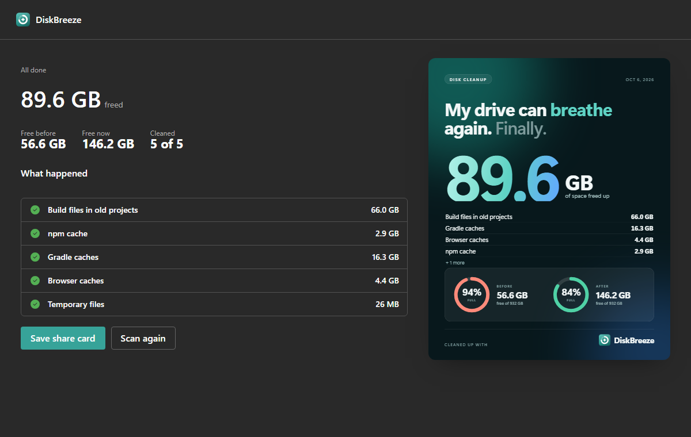
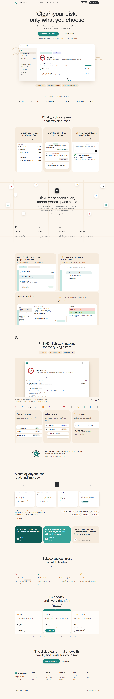

<div align="center">


# DiskBreeze

### Find out what's filling your disk, understand it in plain English, and clean only what you choose.

A free, open-source disk cleaner for Windows that explains every item before it touches anything.

<br>

[](https://github.com/SC136/diskbreeze/releases/latest)
[](https://github.com/SC136/diskbreeze/releases)
[](https://github.com/SC136/diskbreeze/actions/workflows/ci.yml)
[](LICENSE)

<br>

[**Download**](https://github.com/SC136/diskbreeze/releases/latest) &nbsp;·&nbsp;
[Release notes](https://github.com/SC136/diskbreeze/releases) &nbsp;·&nbsp;
[Report an issue](https://github.com/SC136/diskbreeze/issues) &nbsp;·&nbsp;
[Contribute](CONTRIBUTING.md) &nbsp;·&nbsp;
[Landing page](landing/index.html)

<br>



</div>

<br>

## Table of contents

- [Why DiskBreeze](#why-diskbreeze)
- [Screenshots](#screenshots)
- [Download and install](#download-and-install)
- [What it does](#what-it-does)
- [Safety](#safety)
- [Contributing a catalog entry](#contributing-a-catalog-entry)
- [Develop](#develop)
- [Project layout](#project-layout)
- [Landing page](#landing-page)
- [Design](#design)
- [Status](#status)
- [License](#license)

## Why DiskBreeze

Most cleaners show a big scary number and a "Clean" button. DiskBreeze does the opposite: it tells you what each thing is, what you will notice after it is gone, and where it goes.

| | |
| :-- | :-- |
| **Scanning changes nothing** | You review every cleanup on a confirm screen before anything runs. |
| **Plain-English results** | Every finding says what it is and what you will notice after cleaning. |
| **Three honest groups** | *Safe to clean* is pre-ticked, *Your call* never is, *Do it yourself* is only explained. |
| **Recycle Bin first** | Personal files can be recovered. Only caches that rebuild themselves are deleted for good. |
| **Private by design** | Nothing about your files leaves your computer. The one network request is an update check you can turn off. |
| **Open catalog** | 50 known space hogs described in plain TOML that anyone can read and improve, no Rust needed. |
| **No AI** | Everything is rules in the catalog plus a few detectors, so results are predictable and reviewable. |

## Screenshots

<div align="center">

**The app**



<br>



<br>

**The landing page**


<details>
<summary><b>Preview the whole landing page</b></summary>
<br>



</details>

</div>

## Download and install

1. Go to the **[latest release](https://github.com/SC136/diskbreeze/releases/latest)** (the installer is about 2 MB).
2. Run `DiskBreeze_<version>_x64-setup.exe`, or unzip the portable build and run `diskbreeze.exe`.
3. Optional: verify the download against `SHA256SUMS.txt` from the same release.

> [!NOTE]
> DiskBreeze is not code-signed yet, so Windows SmartScreen may warn on first run. Click **More info → Run anyway**. Scanning never changes anything, and you review every cleanup before it runs.

DiskBreeze checks GitHub for updates when it starts and offers them in the app. You can turn this off on the start screen.

## What it does

1. **Scans** (changes nothing) for:
   - known space hogs from a [catalog](catalog/windows.toml): developer caches, browser caches, AI models, shader caches, Windows leftovers…
   - build folders (`node_modules`, `target`, `.venv`…) in code projects you haven't edited in 60+ days, only when the project's marker file is next to them
   - forgotten Downloads: ISOs, archives you already unpacked, installer folders, big old files
   - installed Steam games, with last-played dates
   - the Recycle Bin
   - **OneDrive:** big files you haven't touched in a month that can become online-only (the copy in OneDrive stays; pinned files are never listed)
   - **Docker and WSL:** what Docker could reclaim (unused images, stopped containers, build cache; volumes are never touched), and the disk files WSL and Docker Desktop keep, which can be shrunk to give space back to Windows
   - **Windows system space** that needs administrator permission: downloaded update files, old component versions, the hibernation file. Windows shows its own permission prompt first, and nothing runs unless you allow it
   - your biggest **installed programs**, each with a button that opens its own uninstaller

   **Pick a drive.** The drive that holds your Windows profile gets everything above. Any other drive is searched for old code projects, big loose files (disk images, archives, videos, VM disks, backups), Steam games and its own Recycle Bin. Parts of installed games and apps are never offered.
2. **Sorts** the results into three groups: *Safe to clean* (pre-ticked), *Your call* (never pre-ticked) and *Do it yourself* (needs another app or admin rights, so we only explain).
3. **Cleans** what you tick after a confirm screen. Personal files go to the Recycle Bin. Caches are deleted for good because they rebuild themselves.
4. **Shows a share card** with your before and after numbers.

No AI: everything is rules in the catalog plus a few detectors. The only network request the app makes is an update check against GitHub when it starts (you can turn it off on the start screen); nothing about your files ever leaves your computer.

## Safety

- **Administrator steps are fixed and reviewed.** The commands that run as admin live in the catalog (and a couple of detectors), never come from the UI, are passed to Windows on the command line instead of through a file another program could swap, and are pinned by a test so adding one needs a reviewer to look at it.
- **Everything is logged locally.** *History* in the app lists every cleanup: what, when, how much, and what failed.
- **The UI only ever sends finding ids.** What gets deleted comes from the scan the backend ran itself.
- **Protected paths.** Every delete passes `paths::is_protected` (drive roots, Windows, your profile folders, Program Files…).
- **No wandering.** Symlinks and junctions are never followed. OneDrive cloud-only files count as zero bytes.
- **Validated catalog.** Entries are checked at test time: unknown fields, recycled items marked `safe`, and paths that resolve to protected folders all fail `cargo test`.

## Contributing a catalog entry

The easiest way to help is to add a cleanup target. Edit [`catalog/windows.toml`](catalog/windows.toml). No Rust needed:

```toml
[[item]]
id = "my-tool-cache"
name = "My Tool cache"
category = "Developer caches"
tier = "safe"                      # safe | ask | manual
paths = ['%LOCALAPPDATA%\MyTool\Cache']
what = "What it is, in one plain sentence."
after = "What the user will notice after cleaning."
action = "contents"                # delete | contents | recycle | command | manual
```

If you aren't sure something regenerates, use `ask`, not `safe`. Run `cargo test` in `src-tauri` to validate your entry.

Read the full guide in **[CONTRIBUTING.md](CONTRIBUTING.md)**, or [open an issue](https://github.com/SC136/diskbreeze/issues) to request a new target. macOS and Linux catalogs are welcome too.

## Develop

Requires [Node.js](https://nodejs.org/), [Rust](https://rustup.rs/) and the WebView2 runtime (already on Windows 11).

```bash
npm install
npm run tauri dev        # the real app
npm run dev              # UI only, with mock data (add ?demo=results or ?demo=done)
cd src-tauri && cargo test
cargo run -- --scan-json # read-only scan printed as JSON, handy for bug reports
```

`npm run build` type-checks and builds the UI, and is what CI runs on every pull request.

## Project layout

| Path | What lives there |
| :-- | :-- |
| [`src/`](src) | React 19 + TypeScript UI, with [Fluent UI](https://react.fluentui.dev/) components and the share card (`Poster.tsx`) |
| [`src-tauri/src/`](src-tauri/src) | Rust backend: scanning, detectors, cleaning, admin steps, history |
| [`catalog/windows.toml`](catalog/windows.toml) | The declarative list of known space hogs |
| [`landing/`](landing/index.html) | A static, build-free marketing page |
| [`release-notes/`](release-notes) | Per-version release notes |
| [`docs/screenshots/`](docs/screenshots) | Screenshots used in this README |

## Landing page

A static landing page lives in [`landing/`](landing/index.html). There is no build step: open `landing/index.html` in a browser, or host the folder as-is (GitHub Pages, Netlify, any static server). It only needs `landing/img/` next to it.

## Design

The UI uses [Fluent 2](https://fluent2.microsoft.design/) via `@fluentui/react-components`, so it feels at home on Windows 11 (light and dark follow the system). The brand colour (teal, `src/theme.ts`), the logo and the share card are our own. Keep it that way: use the design system, not Microsoft branding.

## Status

Windows only. Not yet code-signed, so SmartScreen will warn on first run. macOS and Linux catalogs are welcome.

## License

Released under the [MIT License](LICENSE).

<div align="center">
<br>
<sub>Built with <a href="https://tauri.app/">Tauri</a>, React and Rust.</sub>
</div>
